# AISYS Intelligent RFID Library Management System (RFID LMS)

**SOP Compliance:** AISYS Candidate Software Development SOP (Standard Operating Procedure)  
**Deliverables Reference:** `docs/D1` through `docs/D9`, `docs/FINAL_REQUIREMENTS_GAP_AUDIT.md`  
**Current Release:** v1.0.0 (Submission-Ready Prototype)  
**Automated Verification:** 131 / 131 Automated Tests Passing (100% Pass Rate in Isolated Environment)

---

## 1. Project Overview

The **AISYS Intelligent RFID Library Management System (RFID LMS)** is a comprehensive, air-gapped, web-based software application engineered for modern academic, institutional, and research libraries. The system unifies traditional cataloging, circulation, member administration, serials acquisition, and granular reporting with an **event-driven, hardware-neutral simulated RFID middleware architecture**.

The prototype provides an end-to-end interactive simulation environment for high-frequency (13.56 MHz ISO 15693 / ISO 18000-3 Mode 1) and ultra-high frequency (860–960 MHz EPC Gen2 / ISO 18000-6C) workflows—including multi-item staff pad checkout with sliding-window deduplication, wand-based shelf stock auditing with sensory audio chimes, dual-pedestal security gate theft detection with dynamic mock CCTV evidence capture, mock ILS protocol interoperability adapters (NISO NCIP 2.0 and 3M SIP2 mock HTTP endpoints), and spreadsheet-based catalog staging with guaranteed scoped rollbacks.

> **Hardware & Protocol Boundary Note:** This software prototype contains simulated RFID middleware and mock HTTP protocol adapters. It runs completely standalone in an offline or air-gapped workstation environment without requiring physical RFID reader hardware or external cloud services. Protocol adapters are strictly mock HTTP endpoints designed for workflow testing, not certified or full-specification protocol implementations.

---

## 2. Problem Statement

Conventional barcode-driven library management systems suffer from persistent operational bottlenecks:
1. **Line-of-Sight Limitations:** Circulation staff must locate and scan individual barcodes one by one, creating long desk queues during peak hours.
2. **Slow, Inaccurate Shelf Auditing:** Physical inventory checks require weeks of manual labor; books misplaced on adjacent shelves remain effectively lost to patrons.
3. **Ineffective Theft Deterrence:** Barcodes cannot communicate autonomously with security barriers; unauthorized removals often go undetected until annual stock verification.
4. **Protocol Silos & Vendor Lock-In:** Traditional ILS solutions fail to expose standardized interoperability interfaces for self-checkout kiosks and patron authentication.
5. **High-Risk Data Ingestion:** Bulk catalog migrations from legacy spreadsheets often risk database corruption, duplicate collisions, or catastrophic cascading loss when rollbacks are attempted.

---

## 3. Project Objectives

- **Simulate Multi-Tag RFID Middleware:** Provide a hardware-neutral desktop reader pad simulation capable of processing multiple RFID tags concurrently with a 3,000ms sliding-window duplicate suppression algorithm.
- **Automate Circulation & Policy Enforcement:** Enforce reference-only restrictions, patron suspension/block rules, daily overdue fines (\$0.50/day after a 2-day grace period), and maximum fine thresholds (\$15.00 limit).
- **Rapid Shelf Inventory Auditing:** Implement a handheld wand audit interface that cross-references scanned shelf tags against target shelf inventories, immediately flagging missing and misplaced items with distinct audio chimes.
- **Surveillance & Theft Prevention:** Enforce electronic article surveillance (EAS) bit security states (Armed vs. Disarmed), automatically triggering security gate alarms, Server-Sent Events (SSE), and mock CCTV timestamped snapshots.
- **Mock Protocol Interoperability:** Provide documented **mock HTTP protocol adapter boundaries** simulating core workflows of **NISO NCIP 2.0** (NISO Z39.83) and **3M SIP2** (with 2's complement checksum calculation). *(Note: These are mock HTTP testbed endpoints, not certified or full-specification protocol implementations).*
- **Safe 20,000-Record Staging & Scoped Rollback:** Ingest, validate, and atomically commit ~20,000 bibliographic records while strictly isolating records with `migration_batch_id` to guarantee rollbacks never impact pre-existing collection data.
- **100% Air-Gapped & Offline Ready:** Guarantee zero reliance on external cloud APIs, CDN scripts, or third-party paid services.

---

## 4. Key Features and Modules

The application delivers **13 functional modules** accessible via the primary navigation layout:

```
┌────────────────────────────────────────────────────────────────────────┐
│                        AISYS RFID LMS WORKBENCH                        │
├────────────────────┬───────────────────────────────────────────────────┤
│ 1. Executive       │ Real-time metrics: active loans, overdue counts, │
│    Dashboard       │ collection volume, gate violations, audit stream. │
├────────────────────┼───────────────────────────────────────────────────┤
│ 2. Book Catalog    │ Full-text search, ISBN format checks, category/   │
│    & Copies (FR01) │ author mapping, multi-copy accession generator.   │
├────────────────────┼───────────────────────────────────────────────────┤
│ 3. Virtual         │ Dynamic OPAC visualizer: physical spine height    │
│    Bookshelf (OPAC)│ and thickness computed from page counts.          │
├────────────────────┼───────────────────────────────────────────────────┤
│ 4. Members & Smart │ Member lifecycle (Active/Suspended/Blocked),      │
│    Cards (FR01)    │ Indian phone validation (+91), NFC card binding.  │
├────────────────────┼───────────────────────────────────────────────────┤
│ 5. Circulation     │ Atomic checkout, checkin, renewal, due date query,│
│    Desk (FR04)     │ automated fine reconciliation, waiver/payment.    │
├────────────────────┼───────────────────────────────────────────────────┤
│ 6. RFID Tag        │ ISO 28560 encoding format, EAS bit arm/disarm,    │
│    Registry (FR05) │ complete re-tagging audit history.                │
├────────────────────┼───────────────────────────────────────────────────┤
│ 7. Hardware Reader │ Multi-tag staff pad simulation with deduplication,│
│    Simulator (FR03)│ smart card NFC tap login, NCIP 2.0 & SIP2 mocks.  │
├────────────────────┼───────────────────────────────────────────────────┤
│ 8. Handheld Shelf  │ Wand audit reader simulation, expected vs scanned │
│    Inventory (FR06)│ comparison, misplaced book alert, audio chimes.   │
├────────────────────┼───────────────────────────────────────────────────┤
│ 9. Security Gate & │ Dual pedestal theft detection, alarm triggers,    │
│    CCTV (FR07)     │ mock SVG CCTV snapshots, 5s cooldown debounce.    │
├────────────────────┼───────────────────────────────────────────────────┤
│ 10. Data Migration │ ~20,000 synthetic record staging, field error     │
│     & Rollback     │ validation, duplicate checks, scoped rollback.    │
├────────────────────┼───────────────────────────────────────────────────┤
│ 11. Acquisitions   │ Supplier records, purchase orders (Draft/Ordered/ │
│     & Serials      │ Received), serial subscriptions & issue check-in. │
├────────────────────┼───────────────────────────────────────────────────┤
│ 12. Reports &      │ Circulation loans, overdue ledger, member roster, │
│     Analytics      │ fines ledger, gate alarms, CSV/JSON export.       │
├────────────────────┼───────────────────────────────────────────────────┤
│ 13. System Admin   │ RBAC management, diagnostics health, SQLite WAL   │
│     & Offline Ops  │ online backup, air-gapped tar.gz update packaging.│
└────────────────────┴───────────────────────────────────────────────────┘
```

---

## 5. Technology Stack

| Layer | Component | Specification |
|---|---|---|
| **Backend Framework** | Python 3.12+ / FastAPI | High-performance asynchronous REST API framework |
| **Data Validation** | Pydantic v2 | Strict request/response schema modeling and validation |
| **ORM & Database** | SQLAlchemy 2.0 / SQLite 3 | Relational mappings with WAL journal mode and foreign keys enabled |
| **Authentication** | Passlib (Bcrypt) / Python-Jose | JWT Bearer tokens and SHA-256 hashed staff smart card UID tap login |
| **Frontend Framework** | React 18 / TypeScript | Type-safe, component-driven client architecture |
| **Tooling & Build** | Vite 5 | Fast HMR dev server and optimized production bundler |
| **Styling & Icons** | Tailwind CSS / Lucide React | Modern dark-mode interface with accessible SVG typography |
| **Data Visualization** | Recharts | Responsive charting for circulation and inventory analytics |
| **Audio Synthesis** | Web Audio API | Pure client-side synthetic audio tones for inventory chimes |
| **Real-time Push** | Server-Sent Events (SSE) | Unidirectional event stream for gate alarms and circulation broadcasts |
| **Test Automation** | Pytest / TestClient | Automated integration, regression, and SOP compliance test suites |

---

## 6. System Architecture

The application adheres to a clean **7-layer modular architecture** enforcing strict separation of concerns:

```mermaid
flowchart TD
    subgraph Layer1["1. User Presentation Layer"]
        UI["React 18 Single Page App (TypeScript + Vite)"]
        Dashboard["Dashboard & Analytics"]
        CircDesk["Circulation Desk & OPAC"]
        Sim["Simulator & Wand Auditing"]
    end

    subgraph Layer2["2. API & Security Layer"]
        FastAPI["FastAPI REST Endpoints + SSE Broadcaster"]
        Auth["JWT Token Auth & Smart Card Tap RBAC"]
    end

    subgraph Layer3["3. Simulated RFID Middleware Layer"]
        DedupFilter["3000ms Sliding-Window Deduplication Filter"]
        EASManager["EAS Security Bit Manager (Armed/Disarmed)"]
        SensoryAudio["Web Audio API Synthetic Chimes"]
    end

    subgraph Layer4["4. Interoperability Layer"]
        NCIP["NCIP 2.0 Adapter (LookupUser, Checkout, Checkin, Renew)"]
        SIP2["3M SIP2 Adapter (Msg 11, 09, 29, 63 + Checksum)"]
    end

    subgraph Layer5["5. Domain Services Layer"]
        CircSvc["Circulation Service (Fines, Loans, Rules)"]
        CatSvc["Catalog Service (Books, Copies, Dewey)"]
        GateSvc["Gate Service (CCTV Snapshots, 5s Cooldown)"]
        InvSvc["Inventory Service (Shelf Audit & Misplaced Detection)"]
        MigSvc["Migration Service (20k Staging & Scoped Rollback)"]
    end

    subgraph Layer6["6. Relational Data Layer"]
        SQLAlchemy["SQLAlchemy 2.0 ORM"]
        SQLite["SQLite 3 (PRAGMA journal_mode=WAL, foreign_keys=ON)"]
    end

    subgraph Layer7["7. Operations & Offline Layer"]
        BackupSvc["Online Backup Service (PRAGMA integrity_check)"]
        OfflinePkg["Air-Gapped Update Packager & Rollback Script"]
    end

    UI --> FastAPI
    FastAPI --> Auth
    FastAPI --> CircSvc
    FastAPI --> CatSvc
    FastAPI --> GateSvc
    FastAPI --> InvSvc
    FastAPI --> MigSvc
    FastAPI --> NCIP
    FastAPI --> SIP2
    Sim --> DedupFilter
    DedupFilter --> EASManager
    InvSvc --> SensoryAudio
    CircSvc --> SQLAlchemy
    CatSvc --> SQLAlchemy
    GateSvc --> SQLAlchemy
    InvSvc --> SQLAlchemy
    MigSvc --> SQLAlchemy
    SQLAlchemy --> SQLite
    BackupSvc --> SQLite
    OfflinePkg --> FastAPI
```



---

## 7. Simulated RFID Workflow & Security Protocol

### Simulated RFID Memory Model (ISO 28560)
Every simulated physical copy is linked to an `rfid_tags` record containing:
- **`tag_uid`:** Unique 24-character hexadecimal EPC / ISO 15693 identifier (e.g., `E2801160BDC01298C32B4D5E`).
- **`item_type`:** Distinguishes between book items (`book_item`) and patron smart cards (`member_card`).
- **`eas_bit`:** Electronic Article Surveillance bit flag (Boolean).
- **Data Blocks:** Accession number (`ACC-XXXXXX`), library institution code (`AISYS-LIB`), and shelving location.

### EAS Security Bit Lifecycle
```
[In Stacks / Available] ───► EAS = True (Armed)
         │
         ▼ (Checkout Book)
[Loaned to Patron]      ───► EAS = False (Disarmed)
         │
         ▼ (Return Book)
[Returned to Stacks]    ───► EAS = True (Re-Armed)
```

1. **Checkout:** When an item is borrowed via the Circulation Desk, NCIP, or SIP2, the middleware atomically disarms the EAS security bit (`eas_bit = False`). The patron can carry the item through security pedestals without incident.
2. **Security Gate Passage:** When an item passes the simulated security gate:
   - If `eas_bit == False`: Passage is authorized (`authorized_passage`), logged silently.
   - If `eas_bit == True`: Violation detected (`unauthorized_removal`). The gate triggers a high-priority alarm, generates a timestamped dynamic SVG CCTV snapshot, initiates a 5-second cooldown debounce to suppress redundant alerts, logs an immutable audit event, and broadcasts the event over SSE.
3. **Checkin:** Returning the book atomically re-arms the EAS bit (`eas_bit = True`), protecting it once returned to the stacks.

### Sliding-Window Deduplication (3,000ms)
To simulate anti-collision desktop pads and avoid flooding the backend with duplicate radio-frequency packets, the middleware maintains an in-memory timestamp registry. Duplicate tag scans detected within **3,000 milliseconds** are suppressed automatically.

---

## 8. NCIP 2.0 & 3M SIP2 Mock Protocol Adapters

The system provides **mock HTTP protocol adapter endpoints** designed to simulate core interoperability workflows with automated sorters, self-checkout kiosks, and external ILS clients. These mock endpoints demonstrate message parsing, business logic invocation, and response framing over HTTP, but are strictly software mock adapters and are not certified or fully conformant implementations of the complete official specifications:

### NISO NCIP 2.0 Mock Adapter (`/api/interop/ncip`)
Simulates key NISO Z39.83-1-2012 schema concepts using structured JSON request and response envelopes:
- **`LookupUser`:** Validates patron membership number or smart card UID, returning active loan counts and fine balances.
- **`CheckoutItem`:** Validates patron and book status, checks out item, disarms EAS bit, and returns due date.
- **`CheckinItem`:** Returns book, re-arms EAS bit, assesses overdue fines, and provides return shelf location.
- **`RenewItem`:** Evaluates max renewal limits and patron blocks, advancing the due date by 14 days atomically.

### 3M SIP2 Socket Frame Adapter (`/api/interop/sip2`)
Simulates the message structure of the 3M Standard Interchange Protocol over a stateless HTTP adapter boundary:
- **Message 11 / 12 (Checkout):** Parses `11<flags><date>AO<inst>|AA<patron>|AB<item>|`, responds with `121NYY...|AH<due_date>|` and desensitize flag.
- **Message 09 / 10 (Checkin):** Parses `09<flags><date>AO<inst>|AB<item>|`, responds with `101YYN...|AQ<shelf>|` and resensitize flag.
- **Message 29 / 30 (Renew):** Parses `29<flags><date>AO<inst>|AA<patron>|AB<item>|`, validates patron ownership, updates persisted loan due date, and returns `301YYY...|AH<persisted_due_date>|AFRenewal Successful|`.
- **Message 63 / 64 (Patron Status):** Queries member status, screen messages, and card validity.
- **2's Complement Checksum:** Every response computes a valid 4-character uppercase hexadecimal checksum using standard SIP2 arithmetic: `(-sum(ord(c))) & 0xFFFF`.

> [!WARNING]
> **SIP2 Renewal Verification Status Disclosure:** During manual QA testing of SIP2 Message 29 (Renew), a discrepancy was observed where the raw response frame displayed a due date (`08/12/2026`) that differed from the persisted circulation loan record and the Due Date Enquiry screen (`22/12/2026`). Although code-level fixes were applied in `sip2_adapter.py` and `circulation_service.py` to populate the response frame directly from the persisted database transaction (covered by unit test `test_sip2_renewal_regression.py`), live end-to-end multi-client runtime consistency across concurrent browser sessions should not be claimed as fully verified until independently confirmed by subsequent manual testing.

---

## 9. Database Design, Integrity & Security

### Database Configuration
- **Engine:** SQLite 3 configured for high-concurrency production use:
  ```sql
  PRAGMA journal_mode = WAL;         -- Non-blocking readers and writers
  PRAGMA foreign_keys = ON;          -- Strict referential integrity enforcement
  PRAGMA synchronous = NORMAL;       -- Optimal balance of safety and write performance
  ```

### Relational Entity Schema
- **Catalog & Inventory:** `books`, `authors`, `categories`, `book_items`, `rfid_tags`, `rfid_tag_history`.
- **Circulation & Fines:** `members`, `circulation_transactions`, `fines`.
- **Auditing & Security:** `audit_logs`, `gate_events`, `users`, `roles`, `system_settings`.
- **Acquisitions:** `suppliers`, `purchase_orders`, `purchase_order_items`, `serial_subscriptions`, `serial_issues`.
- **Data Migration:** `migration_batches`, `staged_records`.

### Scoped Rollback Guarantee (NFR01, AC01)
Every record created via synthetic generation or spreadsheet upload carries a foreign key `migration_batch_id`. When a rollback is requested:
```sql
DELETE FROM book_items WHERE book_id IN (SELECT id FROM books WHERE migration_batch_id = :batch_id);
DELETE FROM books WHERE migration_batch_id = :batch_id;
UPDATE migration_batches SET status = 'rolled_back' WHERE id = :batch_id;
```
Pre-existing collection books, circulation transactions, and patron histories remain 100% untouched.

---

## 10. Installation and Execution Instructions

### Prerequisites
- **Python:** 3.11 or 3.12+
- **Node.js:** v18+ and `npm`
- **Operating System:** Tested on macOS 12+ and Ubuntu/Debian Linux. *(Note: Windows deployment packaging exists in `dist/`, but native Windows OS execution has not yet been independently verified).*

### Local Workspace Execution

```bash
# 1. Clone or navigate to the repository
cd ~/.gemini/antigravity/scratch/rfid-lms

# 2. Setup Python Virtual Environment
python3 -m venv venv
source venv/bin/activate       # On Windows (experimental): venv\Scripts\activate

# 3. Install Python Dependencies
pip install -r backend/requirements.txt

# 4. Start the FastAPI Backend Server
PYTHONPATH=backend uvicorn backend.main:app --host 127.0.0.1 --port 8000 --reload
```
- Interactive API Documentation (Swagger UI): `http://127.0.0.1:8000/docs`
- Health Diagnostic Check: `http://127.0.0.1:8000/api/admin/health`

```bash
# 5. In a new terminal, launch the Frontend Client
cd ~/.gemini/antigravity/scratch/rfid-lms/frontend
npm install
npm run dev
```
- Access the Web Application at: `http://localhost:5173`

### Production Build & Preview
```bash
cd frontend
npm run build
npm run preview -- --port 4173
```

---

## 11. Verified Demo Credentials & Staff Smart Cards

The database includes pre-configured administrative accounts and smart card tap tokens:

| Role | Username | Password | Smart Card NFC UID | Access Level |
|---|---|---|---|---|
| **System Administrator** | `admin` | `admin123` | `SC-ADMIN-001` | Full administrative control, system settings, updates, backups |
| **Senior Librarian** | `librarian` | `lib123` | `SC-LIB-002` | Cataloging, inventory auditing, acquisitions, reports |
| **Desk Officer** | `staff` | `staff123` | `SC-STAFF-003` | Circulation desk, checkout, checkin, renewals, fines |

*(Tip: On the login screen, click any of the "Quick Fill Demo Credentials" buttons or the "Simulated Smart Card Tap" button for one-click authentication).*

---

## 12. Testing and Verification Results

The test suite provides comprehensive coverage across functional requirements, boundary conditions, and acceptance criteria.

> [!WARNING]
> **DATABASE SAFETY WARNING — ISOLATED TEST EXECUTION ONLY:**  
> Do **NOT** run the full test suite (`pytest backend/tests/`) against the active development or evaluation database (`data/library.db`). Several integration test suites (`test_batch1_core.py`, `test_batch2_circulation_rfid.py`, `test_batch3_advanced.py`, `test_batch4_acceptance_sop.py`, and `test_batch5_gap_completion.py`) use FastAPI's `TestClient` without in-memory database mocking and directly insert persistent records (books, members, copies, transactions, and tags) into the active SQLite database file.
>
> To run the complete suite safely without mutating active data, execute tests against an isolated, temporary database by passing an overridden `DATABASE_URL` or copy the database to an ephemeral scratch location:

```bash
# Safe execution against an isolated ephemeral database (Recommended for CI / Evaluation):
DATABASE_URL="sqlite:////tmp/isolated_test.db" PYTHONPATH=backend pytest backend/tests/ -v

# Run targeted unit tests that use internal isolated temporary databases:
PYTHONPATH=backend pytest backend/tests/test_sip2_renewal_regression.py -v
PYTHONPATH=backend pytest backend/tests/test_auth_rbac.py -v
```

### Verified Test Summary: **131 Tests Passing (in Isolated Test Environment)**
- **`test_auth_rbac.py` (40 tests):** Role permissions, password hashing, smart-card tap login, JWT token decoding, role-based endpoint protection.
- **`test_batch1_core.py` (10 tests):** System health, diagnostics, catalog full-text search, copy generation, member creation, dashboard counters. *(Requires isolated test DB)*.
- **`test_batch2_circulation_rfid.py` (12 tests):** Checkout/checkin flow, reference-only rules, blocked member rules, fine cap enforcement, RFID tag assignment, re-tag history. *(Requires isolated test DB)*.
- **`test_batch3_advanced.py` (8 tests):** Handheld shelf inventory lifecycle, missing/misplaced detection, security gate alarms, CCTV generation, SSE push, CSV 20k staging, scoped rollback. *(Requires isolated test DB)*.
- **`test_batch4_acceptance_sop.py` (10 tests):** Verification of formal SOP Acceptance Criteria AC01 through AC10. *(Requires isolated test DB)*.
- **`test_batch4_backup_offline.py` (8 tests):** Zero-downtime SQLite online backup, SHA-256 verification, tar.gz offline update packaging, signature checking, rollback execution.
- **`test_batch5_gap_completion.py` (8 tests):** Acquisitions workflow, supplier CRUD, purchase orders, serial subscriptions, CSV/JSON report exports, barcode/RFID label generator. *(Requires isolated test DB)*.
- **`test_final_qa_consolidation_regression.py` (5 tests):** Validation of consolidated QA fixes.
- **`test_manual_findings_qa_regression.py` (8 tests):** Historical inventory metric preservation, gate event alarm states, CCTV cooldown debounce.
- **`test_member_validation_regression.py` (10 tests):** Member form validation, Indian phone number format (+91), email regex checks, error handling.
- **`test_opac_dashboard_regression.py` (4 tests):** OPAC bookshelf visualizer, aggregate metrics.
- **`test_sip2_renewal_regression.py` (2 tests):** Isolated temporary database unit test verifying Message 29 renewal date persistence, patron matching, and limit blocking. *(Notice: Live multi-client runtime consistency observed in manual QA requires independent confirmation).*
- **`test_ui_defects_regression.py` (6 tests):** Frontend table mappings, dropdown alignment, and error boundary protections.

---

## 13. Deployment & Offline Operations

### Air-Gapped Workstation Deployment
The application is self-contained and engineered to run in restricted intranet or offline environments:
- **No External Cloud Calls:** No third-party font downloads, no remote CDN scripts. All assets and vendor libraries are bundled locally.
- **Zero-Downtime Online Backups:** Uses SQLite Online Backup API (`backup_service.py`) to create clean, non-locking hot snapshots of `data/library.db` including committed WAL transactions.
- **Air-Gapped Update Packaging (`offline_update_service.py`):** Packages application code updates into cryptographically verified `.tar.gz` archives with SHA-256 manifests. The package includes an automated shell rollback script (`rollback.sh`) to safely revert updates if health diagnostics fail.

### Windows Deployment Packaging & Verification Status
- **Deployment Packaging:** The project includes standalone Windows distribution scripts in `dist/aisys-rfid-lms-windows-x64/` with `start.bat` service launcher and NSSM (Non-Sucking Service Manager) background daemon configuration.
- **Verification Status:** Deployment packaging and batch scripts exist, but **native execution on bare-metal Windows (Windows 11 / Windows Server 2022) has not yet been independently verified**. Development, automated test verification, and interactive QA have been conducted on macOS and Linux environments.

---

## 14. Limitations & Future Enhancements

### Architectural Boundaries & Limitations of the Prototype
1. **Simulated Hardware Interface:** The desktop staff pad, handheld inventory wand, and dual-pedestal security gates operate through high-fidelity web-based simulator controls and REST endpoints. Direct serial port (RS-232/USB) and LLRP (Low Level Reader Protocol) socket drivers are not included in this software prototype.
2. **Mock HTTP Interoperability Adapters:** NCIP 2.0 and 3M SIP2 protocol adapters are exposed strictly as mock HTTP/REST endpoints rather than persistent raw TCP socket daemons. They simulate key business messages and framing logic for testing, but are not certified or full-specification protocol implementations.
3. **Synthetic CCTV Snapshots:** Security gate surveillance records capture dynamically rendered SVG camera frames featuring timestamps and bounding boxes rather than streaming RTSP video feeds.
4. **Native Windows Qualification:** Windows deployment packaging and batch scripts are provided, but native execution on Windows Server 2022 / Windows 11 has not been independently verified on bare metal.
5. **SIP2 Renewal Multi-Client Verification:** Although unit tests verify database persistence for renewal due dates, live multi-client synchronization across concurrent browser sessions observed in manual QA remains pending independent confirmation.

### Planned Enhancements
- **LLRP Native Driver Bridge:** Implement an asynchronous Python socket worker to interface directly with physical Impinj Speedway and Zebra FX9600 fixed RFID readers.
- **Persistent SIP2 TCP Daemon:** Implement a standalone Twisted/asyncio TCP server listening on standard port `6001` for legacy physical self-checkout stations.
- **High-Density Inventory Batching:** Implement WebSockets for millisecond-level telemetry during ultra-dense handheld wand audits (>1,000 tags/minute).

---

## 15. License & Submission Information

- **Project:** AISYS RFID Intelligent Library Management System
- **Evaluation Submission:** Candidate Software Development SOP Compliance
- **License:** Proprietary — Developed exclusively for AISYS evaluation.
